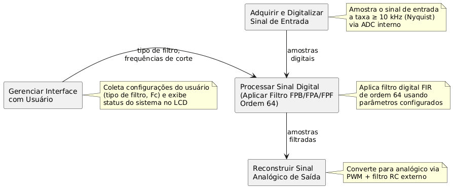
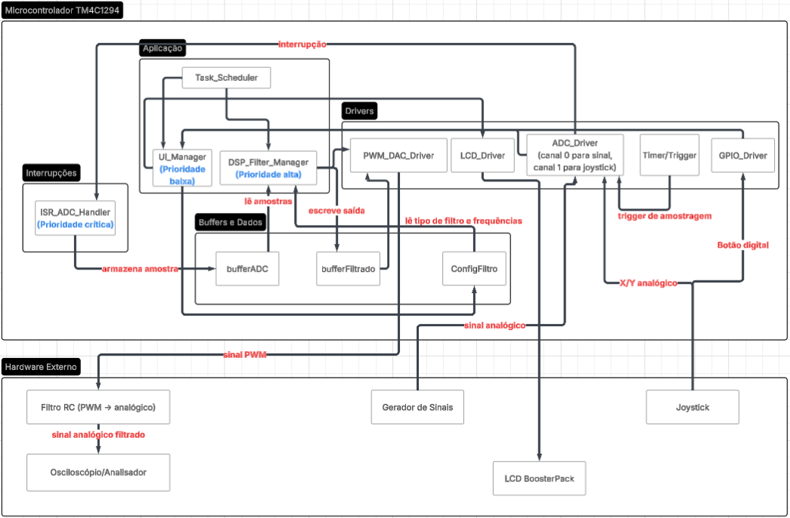
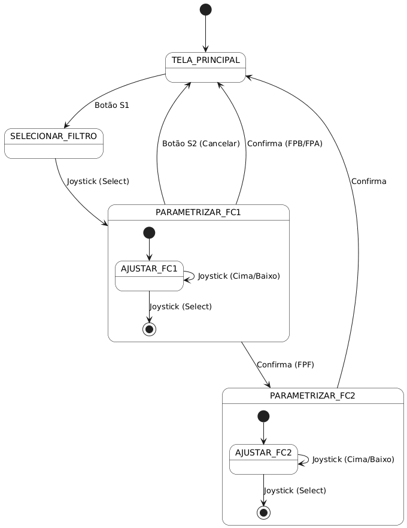
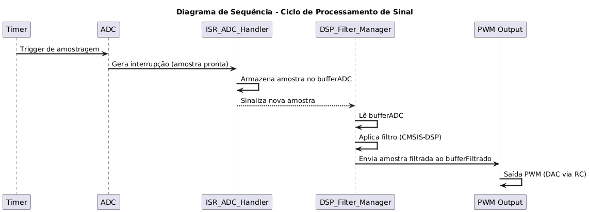

# 

# 

# 

# **Documentação de Projeto – Parte 2** **Design, Estudo da Plataforma**

# 

# 

Projeto:   	Sistema Filtro Digital Parametrizado

Autores:	Diogo Levandoski e Letícia Walger Amaro

**Versão:** 03-Nov-2025

# **Parte 2a – Design**

1. ## **Introdução**

Este documento descreve o design técnico do Sistema Filtro Digital Parametrizado. Ele detalha a arquitetura funcional e física (solução), o design do hardware e o planejamento detalhado do software, incluindo o escalonamento de tarefas. Este design tem como objetivo atender aos requisitos formalizados no documento anterior (Parte 1 \- CONOPS, Domínio do Problema, Especificação).

2. ## **Arquitetura Funcional**



A arquitetura funcional descreve as funções lógicas que o sistema deve executar, independentemente da implementação física. O diagrama funcional do sistema é composto pelas seguintes funções principais:

* **Gerenciar Interface com Usuário:** Coletar as entradas do usuário (tipo de filtro, frequências de corte) e exibir o estado atual do sistema no LCD.  
* **Adquirir Sinal Analógico:** Amostrar o sinal de entrada na interface ADC em uma taxa de amostragem consistente (superior a 10 kHz, conforme Domínio do Problema).  
* **Processar Sinal Digital:** Aplicar o algoritmo de filtro digital (FPB, FPA ou FPF) de ordem 64 sobre as amostras adquiridas.  
* **Gerar Sinal Analógico:** Converter as amostras digitais processadas de volta para um sinal analógico na interface DAC.

3. ## **Arquitetura Física (Arquitetura da Solução)**

A Arquitetura Física descreve como a solução será concretamente implementada no microcontrolador e nos periféricos utilizados. Diferente da arquitetura funcional (que define o que o sistema faz), esta seção apresenta os elementos reais da solução, incluindo hardware, drivers, interrupções, módulos de firmware e estruturas de dados.



O sistema é composto por quatro subsistemas principais:

* Subsistema de Aquisição (ADC)  
* Subsistema de Processamento Digital  
* Subsistema de Saída (DAC/PWM \+ Filtro RC)  
* Subsistema de Interface com o Usuário (IHM LCD \+ Botões/Joystick)

A solução é composta pelos elementos a seguir.

**Hardware:**

| Componente | Função | Observações |
| ----- | ----- | ----- |
| **TM4C1294 (Cortex-M4F)** | Unidade de processamento principal | Suporte à CMSIS-DSP, GPIOs, ADC, PWM |
| **ADC Interno** | Digitaliza o sinal analógico de entrada | Controle por interrupção |
| **PWM/DAC** | Converte o sinal processado para analógico | PWM \+ filtro RC |
| **LCD BoosterPack** | Interface de visualização | Tela gráfica com driver já disponível |
| **Joystick** | Entrada do usuário | Navegação e seleção. Eixos analógicos (ADC) \+ Botão digital (GPIO). |
| **Filtro RC** | Reconstrução analógica | Filtragem passa-baixa para suavização do PWM |

**Software/Módulos de Firmware:**

| Módulo | Tipo | Função |
| ----- | ----- | ----- |
| **ADC\_Driver** | Device Driver | Configura ADC, taxa de amostragem, buffer e interrupções |
| **ISR\_ADC\_Handler** | Interrupção | Guarda amostras no buffer circular |
| **DSP\_Filter\_Manager** | Módulo de processamento | Aplica FPB, FPA e FPF de ordem 64 com CMSIS-DSP |
| **DAC\_Output / PWM\_Driver** | Device Driver | Envia amostras filtradas para a saída |
| **UI\_Manager** | Módulo de aplicação | Controla telas, menus e eventos do usuário |
| **LCD\_Driver** | Device Driver | Escreve na tela LCD |
| **GPIO\_Driver** | Device Driver | Lê joystick |
| **Main Task Scheduler** | Loop principal ou RTOS | Coordena ordem de execução das tarefas |

**Estruturas de Dados Principais:**

| Estrutura | Uso |
| ----- | ----- |
| **bufferADC\[ \]** | Buffer circular de amostras do ADC |
| **bufferFiltrado\[ \]** | Saída do DSP antes de enviar ao DAC |
| **configFiltro** | Tipo do filtro e frequências de corte |

**Fluxo de execução:**

1. ADC amostra o sinal e gera interrupção.  
2. ISR\_ADC\_Handler armazena a amostra no buffer.  
3. DSP\_Filter\_Manager lê amostras e aplica FPB, FPA ou FPF (ordem 64).  
4. O resultado é enviado ao PWM/DAC, que gera sinal analógico.  
5. Usuário configura tudo via UI\_Manager → LCD \+ GPIO.

**Níveis Hierárquicos da Solução:**

**Nível 1 – Hardware**

* Microcontrolador  
* ADC / DAC / PWM  
* LCD  
* Botões/Joystick  
* Filtro RC

**Nível 2 – Drivers**

* ADC\_Driver  
* DAC/PWM\_Driver  
* LCD\_Driver  
* GPIO\_Driver

**Nível 3 – Aplicação**

* UI\_Manager  
* DSP\_Filter\_Manager  
* Scheduler

4. ## **Interface com o Usuário**

O design da solução de IHM será baseado nos mockups de LCD definidos na fase de concepção (Parte 1a, Seção 3). A navegação será implementada usando os botões do BoosterPack mapeados para cima, baixo, direita, esquerda e selecionar.

* **Tela Principal (Status):** Exibe o filtro ativo e Fc. O usuário pode selecionar um deles pressionando o Joystick e navegar entre eles movendo o Joystick para cima e para baixo.  
* **Tela de Seleção de Filtro:** Permite escolher FPB, FPA ou FPF. O usuário navega entre as opções de filtro movendo o Joystick para direita e esquerda e seleciona a opção desejada pressionando o Joystick.  
* **Tela de Parametrização:** Permite o ajuste numérico das frequências de corte. O usuário escolhe entre valores pré-definidos, movendo o Joystick para direita e esquerda e confirma pressionando o Joystick.

5. ## **Mapeamento da Arquitetura Funcional à Arquitetura Física**

| Elemento da Arquitetura Física | Gerenciar Interface | Adquirir Sinal | Processar Sinal | Gerar Saída |
| :---- | :---- | :---- | :---- | :---- |
| **ADC\_Driver** |  | x |  |  |
| **ISR\_ADC\_Handler** |  | x |  |  |
| **Timer/Trigger** |  | x |  |  |
| **DSP\_Filter\_Manager** |  |  | x |  |
| **CMSIS-DSP** |  |  | x |  |
| **bufferADC** |  | x | x |  |
| **bufferFiltrado** |  |  | x | x |
| **ConfigFiltro** | x |  | x |  |
| **PWM\_DAC\_Driver** |  |  |  | x |
| **Filtro RC** |  |  |  | x |
| **UI\_Manager** | x |  |  |  |
| **LCD\_Driver** | x |  |  |  |
| **GPIO\_Driver** | x |  |  |  |
| **Joystick (hardware)** | x |  |  |  |

6. ## **Arquitetura do Hardware**

A plataforma de desenvolvimento central é a Tiva C Series TM4C1294 Connected LaunchPad (EK-TM4C1294XL), que contém o microcontrolador Tiva TM4C1294NCPDT. Este MCU possui um núcleo ARM Cortex-M4F com Unidade de Ponto Flutuante (FPU), característica essencial para o processamento de sinal digital (DSP). A IHM é implementada com o BOOSTXL-EDUMKII Educational BoosterPack Mark II, que fornece o display LCD colorido, os botões S1 e S2, e o joystick analógico. Para a integração desses componentes, periféricos específicos do MCU são utilizados: o ADC adquire o sinal analógico de entrada e lê a posição do joystick; o PWM implementa a funcionalidade de DAC (Conversor Digital-Analógico) para o sinal de saída; portas GPIO leem o estado dos botões S1 e S2; e a interface SPI comunica-se com o display LCD.

7. ## **Design Detalhado**

Para a comunicação entre as tarefas, são definidas estruturas de dados globais. A principal é a configFiltro, uma estrutura que armazena os parâmetros atuais definidos pelo usuário, como o tipo de filtro e as frequências de corte (fc1, fc2). Dois buffers circulares são essenciais: bufferADC armazena amostras recém-adquiridas pela interrupção do ADC, e bufferFiltrado armazena as amostras já processadas, prontas para a saída.

O módulo Gerenciar Interface com Usuário (IHM) é implementado como uma máquina de estados finitos. O estado inicial é a TELA\_PRINCIPAL, que exibe o status atual. Ao pressionar o Botão S1, o sistema transita para o estado SELECIONAR\_FILTRO, onde o usuário navega pelas opções com o Joystick (Cima/Baixo) e confirma com o Joystick (Select). Isso leva ao estado PARAMETRIZAR\_FC1, onde o Botão S2 atua como "Cancelar", retornando à TELA\_PRINCIPAL. No estado PARAMETRIZAR\_FC1, o usuário ajusta a primeira frequência de corte com o Joystick (Cima/Baixo). Se o filtro for Passa-Baixa ou Passa-Alta, pressionar o Joystick (Select) salva o valor e retorna à TELA\_PRINCIPAL. Se for Passa-Faixa, o sistema avança para o estado PARAMETRIZAR\_FC2 para a inserção da frequência de corte alta, e somente após a confirmação neste estado é que o sistema retorna à TELA\_PRINCIPAL.

O fluxo de processamento de sinal é centrado em interrupções. Um timer acionará o ADC em uma taxa de amostragem consistente, superior a 10 kHz. A cada conversão, a rotina de serviço de interrupção (ISR\_ADC\_Handler) é gerada, lendo o dado e armazenando-o no bufferADC. No loop principal, o DSP\_Filter\_Manager monitora o bufferADC. Quando há dados, ele aplica o filtro de ordem 64 usando a biblioteca CMSIS-DSP (conforme RST-01) e salva o resultado no bufferFiltrado. O PWM\_DAC\_Driver, acionado por um timer, consome os dados do bufferFiltrado para gerar o sinal de saída.

O escalonamento de tarefas será cooperativo (um loop principal) com prioridade para interrupções. A tarefa de tempo real com maior prioridade é a ISR\_ADC\_Handler, para garantir que nenhuma amostra seja perdida. As tarefas de background, executadas no loop principal com baixa prioridade, são o DSP\_Filter\_Manager (processamento de filtro) e o IHM\_Manager (leitura de botões e atualização do LCD). A IHM tem a menor prioridade para que o processamento do sinal não seja interrompido.

## ***Diagrama de Estados da IHM***



## ***Diagrama de Sequência \- Ciclo de Processamento de Sinal***



8. ## **Rastreabilidade de Requisitos**

Esta seção apresenta a matriz de rastreabilidade que mapeia cada requisito funcional e não-funcional (definidos na Parte 1 \- Especificação) aos elementos da arquitetura física que os implementam. Esta rastreabilidade garante que todos os requisitos do projeto foram contemplados no design da solução.

| ID do Requisito | Descrição Resumida | Elemento(s) da Arquitetura |
| :---- | :---- | :---- |
| **RF-IHM-01** | Exibir tipo de filtro e Fc no LCD. | SW: Gerenciar Interface com Usuário / HW: BoosterPack LCD  |
| **RF-IHM-02** | Permitir seleção do tipo de filtro. | SW: Gerenciar Interface com Usuário / HW: BoosterPack LCD  |
| **RF-IHM-03** | Permitir inserção de frequências de corte. | SW: Gerenciar Interface com Usuário / HW: BoosterPack LCD  |
| **RF-IHM-04** | Incluir todas as telas e métodos de entrada. | SW: Gerenciar Interface com Usuário |
| **RNF-01** | Processar sinais de 1 Hz a 5 kHz. | SW: Adquirir Sinal Analógico, Processar Sinal Digital |
| **RNF-02** | Processar sinais de 0 a 3V. | HW: Tiva C (ADC)/ SW: Adquirir Sinal Analógico |
| **RNF-03** | Filtros digitais de ordem 64\. | SW: Processar Sinal Digital |
| **RST-01** | Uso obrigatório da biblioteca CMSIS-DSP. | SW: Processar Sinal Digital |
| **RST-02** | Escopo limitado ao HW e SW do sistema. | (Restrição de Gerenciamento) |
| **RST-03** | Equipamentos externos (gerador, osciloscópio). | (Restrição de Gerenciamento) |

# **Parte 2b – Estudo da Plataforma**

1. ## **MCU e LaunchPad**

O hardware central do projeto é a placa de desenvolvimento Tiva C Series TM4C1294 Connected LaunchPad (EK-TM4C1294XL), que utiliza o microcontrolador Tiva™ TM4C1294NCPDT. As características relevantes desta plataforma incluem o núcleo ARM Cortex-M4F operando a 120 MHz, dotado de uma Unidade de Ponto Flutuante (FPU) de hardware. Esta FPU é crucial, pois permite a execução eficiente das operações matemáticas de ponto flutuante exigidas pelos filtros digitais. A plataforma dispõe de módulos ADC (Conversor Analógico-Digital) de 12 bits, que serão usados tanto para amostrar o sinal de entrada (0-3V) na taxa de amostragem definida (\> 10 kHz) como para ler a posição do joystick analógico da IHM. Adicionalmente, um gerador de Modulação por Largura de Pulso (PWM) será usado para implementar a funcionalidade de DAC (Conversor Digital-Analógico), conforme especificado, e as interfaces SPI e GPIO serão usadas para comunicar com o LCD e ler os botões, respectivamente.

2. ##  **IHM (BOOSTXL-EDUMKII)**

A interface com o usuário (IHM) é fornecida pelo módulo BOOSTXL-EDUMKII (Educational BoosterPack Mark II), que se conecta diretamente ao LaunchPad. Este módulo fornece os periféricos necessários para atender aos requisitos, incluindo o display LCD colorido (128x128 pixels) para exibição de dados (RF-IHM-01, RF-IHM-04), dois botões de propósito geral (S1, S2) lidos através de pinos de GPIO, e um joystick analógico. O joystick, lido por dois canais do ADC do Tiva, juntamente com os botões, atende plenamente aos requisitos de seleção e parametrização (RF-IHM-02, RF-IHM-03).

3. ## **Biblioteca CMSIS-DSP**

A plataforma de software é definida pela restrição RST-01 do projeto, que exige o uso obrigatório da biblioteca CMSIS-DSP. Esta é uma biblioteca de software otimizada, fornecida pela ARM, para aplicações de processamento digital de sinal em microcontroladores Cortex-M. Ela é projetada para explorar ao máximo os recursos do núcleo Cortex-M4F, utilizando intensivamente a FPU de hardware e as instruções SIMD (Single Instruction, Multiple Data). Para este projeto, que especifica um filtro de ordem 64, as funções de filtro FIR (Finite Impulse Response) da biblioteca, como arm\_fir\_init\_f32 e arm\_fir\_f32, são as mais indicadas. O componente de software Processar Sinal Digital utilizará estas funções para executar a filtragem em tempo real com o desempenho necessário.

### 3.1 Funções de Filtro FIR na CMSIS-DSP

A biblioteca CMSIS-DSP oferece implementações otimizadas de filtros FIR 
(Finite Impulse Response) para diferentes tipos de dados. Para este projeto, serão 
utilizadas as funções de ponto flutuante (sufixo _f32), que exploram a 
FPU do Cortex-M4F para máxima performance em operações de processamento 
digital de sinais.

3.1.1 Estrutura de Dados do Filtro FIR

A biblioteca utiliza a estrutura arm_fir_instance_f32 para armazenar o 
estado do filtro:
```c
typedef struct {
    uint16_t numTaps;         // Número de coeficientes (ordem + 1)
    float32_t *pState;        // Buffer de estado interno
    float32_t *pCoeffs;       // Ponteiro para os coeficientes
} arm_fir_instance_f32;
```

**Campos:**
- **numTaps**: Para um filtro de ordem N, numTaps = N + 1. No projeto, 
  ordem 64 → numTaps = 65
- **pState**: Buffer que armazena histórico de amostras necessário para a 
  convolução. Tamanho: (numTaps + blockSize - 1)
- **pCoeffs**: Array com os coeficientes do filtro {b₀, b₁, b₂, ..., b₆₄}

3.1.2 Função de Inicialização: arm_fir_init_f32()

Esta função prepara a instância do filtro para operação, configurando ponteiros 
e zerando o buffer de estado.

**Protótipo:**
```c
void arm_fir_init_f32(
    arm_fir_instance_f32 *S,
    uint16_t numTaps,
    const float32_t *pCoeffs,
    float32_t *pState,
    uint32_t blockSize
);
```

**Parâmetros:**
- **S**: Ponteiro para a instância do filtro
- **numTaps**: 65 (para filtro de ordem 64)
- **pCoeffs**: Array de 65 coeficientes (calculados externamente)
- **pState**: Buffer de estado, tamanho (65 + blockSize - 1)
- **blockSize**: Número de amostras processadas por chamada

**Uso:** Esta função deve ser chamada **uma única vez** durante a inicialização 
do sistema, antes de começar o processamento de sinais.

3.1.3 Função de Processamento: arm_fir_f32()

Executa a filtragem FIR sobre um bloco de amostras.

**Protótipo:**
```c
void arm_fir_f32(
    const arm_fir_instance_f32 *S,
    const float32_t *pSrc,
    float32_t *pDst,
    uint32_t blockSize
);
```

**Parâmetros:**
- **S**: Instância do filtro previamente inicializada
- **pSrc**: Buffer com as amostras de entrada
- **pDst**: Buffer onde serão escritas as amostras filtradas
- **blockSize**: Número de amostras a processar

**Operação matemática:**
Para cada amostra de saída y[n], a função calcula:

y[n] = Σ(k=0 até 64) b[k] × x[n-k]

onde b[k] são os coeficientes do filtro e x[n-k] são as amostras de entrada 
atuais e passadas. Esta é a equação clássica de convolução discreta para 
filtros FIR.

**Uso:** Esta função é chamada repetidamente no loop principal, processando 
blocos consecutivos de amostras.

3.1.4 Otimizações Implementadas pela CMSIS-DSP

A função arm_fir_f32() utiliza diversas técnicas de otimização específicas 
para processadores ARM Cortex-M:

**1. Loop Unrolling:**
O loop interno é desenrolado para processar múltiplas multiplicações por 
iteração, reduzindo overhead de controle.

**2. Uso Intensivo da FPU:**
Todas as operações de ponto flutuante são executadas pela FPU de hardware, 
proporcionando execução eficiente de operações MAC (Multiply-Accumulate).

**3. Gerenciamento Automático do Buffer de Estado:**
O buffer de estado é atualizado automaticamente, mantendo continuidade 
entre blocos consecutivos sem overhead adicional no código do usuário.

**Performance Estimada:**
- Ciclos por tap por amostra: aproximadamente 2-3 ciclos
- Para filtro de ordem 64 (65 taps): ~150-200 ciclos por amostra
- A 120 MHz: aproximadamente 1.5 µs por amostra
- Para bloco de 64 amostras: cerca de 100 µs de tempo total de processamento

Esta performance é suficiente para processar sinais em tempo real a 12 kHz 
com margem de segurança significativa.

3.1.5 Cálculo dos Coeficientes do Filtro

Os coeficientes do filtro FIR devem ser calculados externamente usando 
ferramentas de design de filtros, uma vez que a biblioteca CMSIS-DSP apenas 
executa a filtragem, não o design. As principais ferramentas disponíveis são:

- **MATLAB Filter Design Toolbox**: função fir1() com janelamento
- **Python scipy.signal**: função firwin() para design de filtros FIR
- **Ferramentas online**: TFilter, Iowa Hills Digital Filter Designer

Para filtros FIR, os métodos de design mais comuns são:
- **Janelamento (Window Method)**: Hamming, Hanning, Blackman
- **Método de Parks-McClellan**: Para especificações mais rigorosas
- **Método da Amostragem em Frequência**: Para respostas específicas

Para este projeto, o método de janelamento com janela de 
Hamming será utilizado, que oferece bom compromisso entre atenuação da banda de rejeição 
e largura da banda de transição.

**Tipos de Filtros Implementáveis:**

| Tipo | Descrição | Parâmetros | Aplicação no Projeto |
|------|-----------|------------|---------------------|
| **Passa-Baixa** | Permite frequências abaixo de fc | fc | Remover componentes de alta frequência |
| **Passa-Alta** | Permite frequências acima de fc | fc | Remover componentes de baixa frequência |
| **Passa-Faixa** | Permite frequências entre fc1 e fc2 | fc1, fc2 | Selecionar banda específica |

Para este projeto, será necessário calcular três conjuntos distintos de 
coeficientes (FPB, FPA, FPF) que serão armazenados em memória Flash e 
carregados conforme a seleção do usuário.

3.1.6 Características dos Filtros FIR

**Vantagens:**
- **Estabilidade garantida**: FIR é sempre estável independentemente dos 
  coeficientes (todos os polos estão na origem do plano z)
- **Fase linear**: Não distorce o formato temporal das formas de onda, 
  importante para preservar a forma do sinal
- **Fácil implementação**: Requer apenas multiplicações e somas
- **Projeto intuitivo**: Métodos de design bem estabelecidos e documentados

**Desvantagens:**
- **Ordem elevada necessária**: Para alta seletividade em frequência, são 
  necessários muitos coeficientes
- **Latência fixa**: Introduz atraso de grupo constante
- **Custo computacional**: Proporcional à ordem do filtro

**Atraso de Grupo:**
Filtros FIR com fase linear (simetria nos coeficientes) introduzem atraso 
de grupo constante de N/2 amostras, onde N é a ordem.

Para o filtro de ordem 64:
- Atraso = 64/2 = 32 amostras
- Em tempo: 32 / 12000 Hz = 2.67 ms
- Este atraso é constante para todas as frequências (característica de fase linear)

# 
