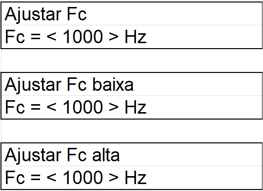
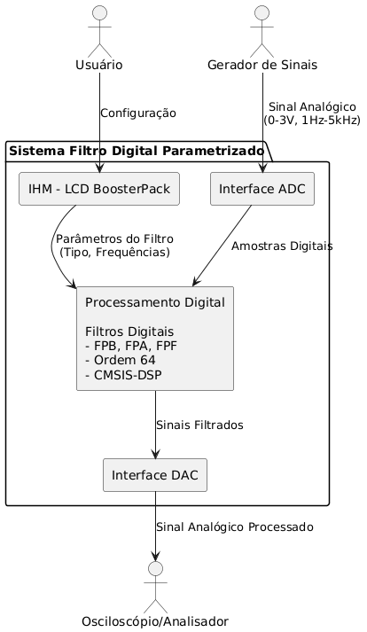

# 

# 

# 

# **Documentação de Projeto – Parte 1** **CONOPS, Domínio do Problema, Especificação**

# 

# 

Projeto:   	Sistema Filtro Digital Parametrizado

Autores:	Diogo Levandoski e Letícia Walger Amaro	

**Versão:** 01-Nov-2025

# **Parte 1a – CONOPS**

1. ## **Introdução**

O Sistema Filtro Digital Parametrizado é um sistema embarcado para processamento de sinais. Sua principal funcionalidade é adquirir um sinal analógico, aplicar um filtro digital com características configuráveis pelo usuário e, em seguida, converter o sinal digital filtrado de volta para analógico. O usuário pode selecionar o tipo de filtro (Passa-Baixa, Passa-Alta, Passa-Faixa) e definir suas frequências de corte através de uma interface de usuário local. O sistema é aplicável em um contexto de laboratório acadêmico, permitindo a análise e visualização dos efeitos da filtragem digital em sinais com frequências de 1 Hz a 5 kHz. Outras aplicações incluem em equipamentos de áudio, como equalizadores ou *crossovers* de caixas acústicas, para separar e ajustar faixas de frequência específicas. Além disso, seria aplicável em instrumentação biomédica ou industrial para filtrar ruídos de sinais de sensores em tempo real, melhorando a precisão de medições.

2. ## **Descrição do Sistema**

O sistema a ser desenvolvido atua como um bloco de processamento entre dois equipamentos de laboratório existentes: um Gerador de Sinais e um Osciloscópio/Analisador de Espectro.

O diagrama estrutural do sistema e seu contexto operacional é composto por três interfaces principais:

* **Interface de Entrada (ADC):** Recebe um sinal analógico (0-3V, 1 Hz-5 kHz) de um Gerador de Sinal.  
* **Interface de Saída (DAC):** Envia o sinal analógico processado para um Osciloscópio ou Analisador de Espectro para visualização.  
* **Interface com o Usuário (IHM):** Uma "IHM de parametrização" que permite ao usuário configurar o comportamento do filtro.

Internamente, o sistema implementará filtros digitais de ordem 64\.

3. ## **Interface com o Usuário**

A interface com o usuário será implementada em um display LCD de um *boosterpack*. Esta interface é o único meio pelo qual o usuário irá parametrizar o sistema.

A descrição informal da interface planejada é:

* **Tela Principal/Menu:** Apresentará o status atual (filtro ativo, frequências) e permitirá a navegação para as telas de configuração. 

* **Tela de Seleção de Filtro:** Permitirá ao usuário escolher entre os tipos de filtro disponíveis: FPB (Filtro Passa-Baixa), FPA (Filtro Passa-Alta) e FPF (Filtro Passa-Faixa).

* **Tela de Parametrização:** Permitirá ao usuário escolher os valores numéricos para as frequências de corte de acordo com o filtro selecionado. No caso do FPF (Filtro Passa-Faixa), o usuário escolherá primeiro a frequência de corte baixa e depois a alta.

4. ## **Identificação dos Stakeholders**

Os seguintes papéis/pessoas têm interesse no sistema:

* **Cliente:** O professor da disciplina, que definiu os requisitos do projeto e avaliará a solução final.  
* **Usuário:** Alunos da disciplina de Sistemas Embarcados ou técnicos de laboratório que utilizarão o sistema para fins didáticos e de teste.  
* **Desenvolvedor:** Os autores do projeto, responsáveis por projetar, implementar e documentar o sistema.

5. ## **Necessidades de Stakeholders**

A lista informal de necessidades dos stakeholders é:

* **Usuário:**  
  * Precisa ser capaz de aplicar um filtro digital a um sinal de entrada vindo de um gerador.  
  * Precisa poder escolher entre um filtro Passa-Baixa, Passa-Alta e Passa-Faixa.  
  * Precisa poder definir as frequências de corte do filtro selecionado.  
  * Precisa que a interface no LCD seja clara e fácil de usar para fazer essas configurações.  
  * Precisa ver o resultado do sinal filtrado em um osciloscópio.  
  * Precisa que o sistema funcione para sinais de entrada na faixa de 1 Hz a 5 kHz e com amplitude de 0 a 3V.  
* **Cliente:**  
  * Precisa que o sistema implemente corretamente filtros de ordem 64\.  
  * Precisa que a solução utilize a biblioteca CMSIS-DSP.  
  * Precisa que a IHM seja feita no display LCD do boosterpack.  
* **Desenvolvedor:**  
  * Precisa de acesso aos equipamentos de laboratório (Gerador de Sinais, Osciloscópio) para testar o sistema.  
  * Precisa dos requisitos claros de operação e parametrização.

6. ## **Cenários de Operação**

**Cenário 1: Operação Normal (Filtro Passa-Baixa)**

1. O Usuário conecta um Gerador de Sinais à entrada ADC e um Osciloscópio à saída DAC.  
2. O Usuário liga o sistema. A IHM exibe o menu principal.  
3. O Usuário configura o Gerador para um sinal senoidal de 2V com frequência de 2 kHz.  
4. Na IHM, o Usuário seleciona o tipo de filtro "FPB" e define a frequência de corte como 1 kHz.  
5. O Usuário confirma a seleção. O sistema começa a processar.  
6. O Usuário observa no Osciloscópio que o sinal de 2 kHz na saída está visivelmente atenuado, conforme esperado para um filtro passa-baixa.

**Cenário 2: Reparametrização**

1. Seguindo o Cenário 1, o sistema está rodando com um FPB de 1 kHz.  
2. O Usuário, através da IHM , altera o tipo de filtro para "FPA" (Filtro Passa-Alta) e mantém a frequência de corte em 1 kHz.  
3. O sistema aplica a nova configuração.  
4. O Usuário observa no Osciloscópio que o sinal de 2 kHz agora passa sem atenuação (ou com pouca atenuação).

**Cenário 3: Situação Anormal (Sinal de Entrada Fora da Faixa)**

1. O Usuário configura um filtro FPA de 1 kHz.  
2. O Usuário ajusta o Gerador de Sinais para uma amplitude de 4V, que está acima do limite especificado de 3V.  
3. A entrada ADC do sistema satura.  
4. O Usuário observa no Osciloscópio um sinal de saída distorcido ("clipado"), independentemente da configuração do filtro. O sistema, no entanto, não deve travar e deve continuar operando.

# **Parte 1b – Domínio do Problema**

O objetivo desta seção é descrever os conceitos relevantes do domínio de Processamento Digital de Sinais (PDS) aplicados ao desenvolvimento do Sistema Filtro Digital Parametrizado.

1. ## **Processamento Digital de Sinais (PDS)**

O PDS é a área da engenharia que trata do processamento de sinais por meios digitais. Diferente do processamento analógico, no PDS o sinal é primeiro digitalizado (amostrado e quantizado), processado por um algoritmo em um processador digital (como um microcontrolador) e, frequentemente, convertido de volta para a forma analógica. Este projeto foca em uma das principais aplicações do PDS: a filtragem digital.

2. ## **Amostragem e Conversão Analógico-Digital (ADC)**

Para que um sinal analógico contínuo no tempo (como o proveniente do Gerador de Sinais) possa ser processado digitalmente, ele precisa ser convertido em uma sequência de números digitais. Esse processo é feito pelo Conversor Analógico-Digital (ADC).

* **Amostragem:** O sinal é medido em intervalos de tempo regulares, definidos pela "taxa de amostragem".  
* **Teorema de Nyquist:** Para evitar a perda de informação (aliasing), a taxa de amostragem deve ser, no mínimo, duas vezes maior que a maior frequência presente no sinal de entrada. Dado que o sinal de entrada pode chegar a 5 kHz, a taxa de amostragem do sistema deverá ser superior a 10 kHz.  
* **Quantização:** A amplitude de cada amostra é representada por um número digital finito, o que introduz um erro de quantização. A tensão de entrada do sistema é especificada como 0 a 3V.

3. ## **Filtros Digitais**

Um filtro digital é um algoritmo que opera sobre uma sequência de amostras digitais (o sinal de entrada) para produzir uma nova sequência (o sinal de saída), atenuando ou realçando bandas de frequência específicas. O projeto utilizará três tipos de filtros:

* **Filtro Passa-Baixa (FPB):** Permite a passagem de frequências abaixo de uma frequência de corte definida, atenuando frequências mais altas.  
* **Filtro Passa-Alta (FPA):** Permite a passagem de frequências acima de uma frequência de corte, atenuando frequências mais baixas.  
* **Filtro Passa-Faixa (FPF):** Permite a passagem de frequências dentro de uma faixa definida por duas frequências de corte, atenuando as demais.

A ordem do filtro (definida como 64 neste projeto) está relacionada à complexidade do filtro e à sua capacidade de atenuar frequências indesejadas. Filtros de ordem mais alta geralmente têm uma transição mais abrupta entre a banda de passagem e a banda de rejeição.

4. ## **Conversão Digital-Analógica (DAC)**

Após o processamento digital (filtragem), a sequência de amostras resultante é convertida de volta para um sinal analógico contínuo pelo Conversor Digital-Analógico (DAC). Isso permite que o sinal processado seja visualizado em equipamentos analógicos, como um osciloscópio. Uma alternativa mencionada é o uso de PWM (Modulação por Largura de Pulso) seguido de um filtro passa-baixa analógico (rede RC) para realizar essa conversão.

5. ## **Biblioteca CMSIS-DSP**

A CMSIS (Common Microcontroller Software Interface Standard) é um padrão da ARM para microcontroladores Cortex-M. A biblioteca CMSIS-DSP, um componente desse padrão, fornece uma coleção de funções otimizadas para tarefas de PDS, como operações matemáticas, transformadas (FFT) e implementação de filtros digitais. O uso desta biblioteca é um requisito e é fundamental para o domínio do problema, pois garante que os algoritmos de filtragem sejam executados de forma eficiente no hardware embarcado, permitindo o processamento necessário para a aplicação.

# **Parte 1c – Especificação**

1. ## **Introdução**

Esta seção detalha os requisitos funcionais, não funcionais e as restrições do sistema. Estes requisitos servem como contrato formal para o desenvolvimento e validação do projeto, fazendo referência às necessidades dos stakeholders identificadas na Parte 1a.

2. ## **Estrutura do Sistema**

Componentes Principais do Sistema

1\. Interface ADC (Analog-to-Digital Converter)

* Função: Conversão do sinal analógico de entrada para formato digital  
* Entrada: Recebe sinal analógico do gerador de sinais (0-3V, 1Hz-5kHz)  
* Saída: Fornece amostras digitais para processamento  
* Característica: Interface de aquisição que digitaliza o sinal contínuo

2\. Processamento Digital

* Função: Núcleo de processamento do sistema  
* Capacidades:  
  * Implementa três tipos de filtros: Passa-Baixa (FPB), Passa-Alta (FPA), Passa-Faixa (FPF)  
  * Filtros de ordem 64 para resposta frequencial precisa  
  * Utiliza biblioteca CMSIS-DSP para eficiência computacional  
* Processo: Aplica algoritmos de filtragem digital às amostras adquiridas

3\. Interface DAC (Digital-to-Analog Converter)

* Função: Reconversão do sinal processado para formato analógico  
* Entrada: Recebe sinais digitais filtrados  
* Saída: Fornece sinal analógico processado para visualização  
* Implementação: Pode utilizar DAC hardware ou PWM com filtro RC

4\. IHM \- LCD BoosterPack

* Função: Interface primária de interação com o usuário  
* Display: LCD do boosterpack para visualização  
* Funcionalidades:  
  * Seleção do tipo de filtro (FPB, FPA, FPF)  
  * Configuração de parâmetros (frequências de corte)  
  * Visualização do status do sistema

Interfaces Externas do Sistema

Ator: Gerador de Sinais

* Papel: Fonte do sinal analógico a ser processado  
* Características do sinal: 0-3V de amplitude, frequência de 1Hz a 5kHz  
* Conexão: Interface ADC do sistema

Ator: Osciloscópio/Analisador

* Papel: Equipamento de visualização do resultado  
* Função: Permite análise do sinal processado no domínio do tempo e frequência  
* Conexão: Interface DAC do sistema

Ator: Usuário

* Papel: Operador e configurador do sistema  
* Interação: Através da IHM para parametrização dos filtros  
* Capacidades: Seleção de tipo de filtro e definição de frequências de corte

Fluxo de Operação Principal

Aquisição: Sinal analógico \-\> Interface ADC \-\> Amostras digitais

Configuração: Usuário \-\> IHM \-\> Parâmetros do processamento

Processamento: Amostras digitais \+ Parâmetros \-\> Filtro digital \-\> Sinais filtrados

Saída: Sinais filtrados \-\> Interface DAC \-\> Sinal analógico processado

Visualização: Sinal processado \-\> Osciloscópio para análise

3. ## **Especificação Funcional**

Esta seção detalha as funções que o sistema deve executar.

* **RF-01:** O sistema deve adquirir um sinal analógico através da sua interface de entrada (ADC).  
* **RF-02:** O sistema deve gerar um sinal analógico processado através da sua interface de saída (DAC).  
* **RF-03:** O sistema deve aplicar um filtro digital ao sinal adquirido antes de o enviar para a saída.  
* **RF-04:** O sistema deve fornecer a funcionalidade de Filtro Passa-Baixa (FPB).  
* **RF-05:** O sistema deve fornecer a funcionalidade de Filtro Passa-Alta (FPA).  
* **RF-06:** O sistema deve fornecer a funcionalidade de Filtro Passa-Faixa (FPF).  
* **RF-07:** O sistema deve permitir ao usuário definir as frequências de corte para o filtro selecionado.

  1. ## ***Especificação da Interface com o Usuário***

Esta seção detalha os requisitos da Interface Homem-Máquina (IHM).

* **RF-IHM-01:** A IHM deve ser implementada e exibida no display LCD do boosterpack.  
* **RF-IHM-02:** A IHM deve apresentar ao usuário uma opção para selecionar o tipo de filtro (FPB, FPA ou FPF).  
* **RF-IHM-03:** A IHM deve permitir ao usuário inserir valores numéricos para as frequências de corte.  
* **RF-IHM-04:** A IHM deve incluir todas as telas e métodos de entrada de dados necessários para a configuração completa dos parâmetros do filtro.

4. ## **Especificação Não Funcional**

Esta seção apresenta as características não funcionais e de desempenho do sistema.

* **RNF-01:** O sistema deve ser capaz de processar sinais de entrada na faixa de frequência de 1 Hz a 5 kHz.  
* **RNF-02:** O sistema deve ser capaz de processar sinais de entrada na faixa de amplitude de 0 a 3V.  
* **RNF-03:** Todos os filtros digitais implementados devem ser de ordem 64\.

5. ## **Restrições**

São requisitos que limitam as escolhas de implementação ou o processo de desenvolvimento.

* **RST-01:** A solução de software deve obrigatoriamente utilizar a biblioteca CMSIS-DSP para as operações de processamento digital de sinal.  
* **RST-02:** O escopo do projeto a ser desenvolvido inclui apenas o HW e SW do Sistema Filtro Digital Parametrizado.  
* **RST-03:** O gerador de sinais e o osciloscópio são equipamentos externos, fornecidos pelo laboratório, e não fazem parte do escopo de desenvolvimento.  
* **RST-04:** A interface de usuário deve ser implementada especificamente no display LCD do boosterpack.

[image1]: <data:image/png;base64,iVBORw0KGgoAAAANSUhEUgAAARoAAAA2CAYAAAAYqlZDAAAFCElEQVR4Xu2d25GjMBAAHRcBOR6iIRl+NhPfChAMeo7WjC37uqvmyjYDEjrUC+J1ewAAGHNb/rndCIIgLo9INAAAV4JoAMAcRAMA5iAaADAH0QCAOS8UzRSNQqfiPq3Z9+17OO/O7H4bju9vwNexFi3592kWJfwy3aMcGcN9POcDdIjsBy8RjRdJG7FohuV7H6LRUsqf53lfx1G6ZhNN1Gy/+fdhE87fGhXgZSCaJyiJI0Utfx6HWBw50Wys7TKc5QTQGSrR+A4S7tW3gWg0+eF61kQzslcDH4BKNG43fe3YR0xzq3XaRFMao5H1kMv0n6f7MW3/S7+M6ZznczFEFdoOYYb62IdGHBJNvq/XTkU0fl0HdmmgY+Q2nReNYBrvJ+kMwz1MyXCdaBypPRqf42LpdrMv7JjfC3KexqfHODTikNTz/TiNaNOKaJ6pP8CrkNu9SjSSWZ4Rqe4BpPcoZMg/ys+IJux3pQ5emlbDz5uPc/1KZTnx+flO1eesE3wBcrv/DtH81iM8iCjWb147+F+OPP4qmlJE9aiIZonEOgP0hNtO98/hDym6P3RKdLrl92zB6+FKdnKB0h5Kitb8hcqhkxyPAugVnWg6Gwx2XCeatnpJWsXRmr9QEY1j/z8JJwB0gtzus6LxHeSVp7cvF03mVLi/dkVZrROt4mjNX6iK5rjQL1xvgF7QiWYYLtiI3yeaUgf308J5NJSWm6I1f6Emmm2MqXm5AC9EJZpruFY0KUHkRCPn7/v0doKCaNoG4wHex8eKZr9cX4jCd7hYNI/lmpo9X0RvF+xFKM46JdcXoCPkdm8sGgD4X0E0AGAOogEAcxANAJiDaADAHEQDAOYgGgAwB9EAgDmIBgDMQTQAYI5SNOnL98OIruY3xpVZLnJ+DNv9TEP1xlCrXInuNoy1PbXP+QHoH+mVjxKNvyEyW2TmHqFkHa1yIxAN/J+4bXr/HP5woOsgr0I+hCtXpVRn9fOFWOXG6NoxVQbAJ/NRopnHY29i3D6nqpR/mNV6Z7Z8NYlVbhpdOyIa+DbsRDNPx/Ne9gifctfydLhpfcyCf0Zx9jkt8/5StRRLeeIREJpcX7eW3DS6dlzb5BDN6ZEYiSiXCfB+ZL+5VDThM4Z9nJfRKBr5IPSsaDYhJdcj7sSaXF9GS24aXTuGdUQ08OnIfnOdaMSAqUQ/lqEgJ5p5TD7m0xNOC79L/DR/RNSSm0Y3qL5G+dDJv/1A/X8C8EZkv6+KphSpdzJFneCJdyhFVEWT7qhr3ULRlHPPotHlpqm34xHpcha8yKMGBugTt73un8MfDtr2aHxHUab/japoynseue+ScC+lJTeNrh3LovGyyk0H6A870VQHRp8kJ5rH943RSNZp6ToA9IqJaHR/3Z8kK5pj/CLF0lHFiljlptG1Y040SAY+FRPR+NPAccdrW06Rgmj8WFBUzjbPSYBWuUl0658SzSrvzPoCdI6JaORp6/11JuJ1J5dQEs3j6Jj3cc1w7wxfy4/HWKxyY3TtuC7vEI0Xd20+gF6R/f5C0TwyF+yF13y0XEcTUBGNw0vhiLwMrHLP6NpxXeYhmnNZiagtEODNuO10/xz+cKDrICnc63R9Z4zf3W0rGrd8f5f1rXqXtVWuRNeOa5sgGvge3Ha6fw5/AAC4AkQDAOYgGgAwB9EAgDmIBgDMOYnm5+cnPqNBEARxQTi/LI4RAgIAMAHRAIA5/wDLNjdZGxPDxAAAAABJRU5ErkJggg==>

[image2]: <data:image/png;base64,iVBORw0KGgoAAAANSUhEUgAAARoAAAA3CAYAAADT9oXmAAAH5klEQVR4Xu2dabKrIBCFsy4X5HpcTTbjn7eTvCA2NM1hcMpwc76qrkqUWfqImMDtsfLv3z/5SAghh9GackMHCSHkKBQaQsjlJELjvji73W40Go12qgV9CYpzCx8JIeQwWlMoNISQS6DQEEIuh0JDCLmc7UIzz49hGB6DTPI8P0/32YbaxLim9dc5v573bMINmZDm7+OO93DaHz12KQmBbBKaIC4FM322m/Md8DM5v54nCs08Ld8nCg25AN0Pq0JzH30nxR1xzjr1Fs53wM/k/HriUUkfFBryOrqFxo9mBns4ch93d9TzHfAzOb+eFBryHWwUmvx4i3HIh/K3YUrDoLRn8Fhg4gl5HlgQ4aMfShPl/bRuH1ydVtvw9OjuenbntU1oSo9OMlrVJmnK53gutu00Dlm8/rKTXyL2u4bQyIjF2TBOXRPA0rGXzrcGv09rOsrBcweMzleL55hWkXGO7Jjv4uRjEk7Su0uCT3cQgUrv4jFvCRvTBO2SkZfdOmQtrKunCGK7hc8RmoXCiEbKJ+0rl11f233tRH4J3SfqQvPQdzUx98ap3MtDGNN57ejICs08ecdsxXOgjl0Ml41evLMNKiPJWx9ziKC1nFrij0aIZyXU4VihnuL0rbwysWhwRGgscnxvO5HfQvehptA49F3LWjow8I6F+5vv5NJHrdD49NIRiSeNlzmLUHAaxJKXJBDEAD96lcsVqcW3AlhLz7cJTieCH7uipfH3C40pY2M+DsYhP03S79HBJsvvamLnlr6Hnvutyd0QC03Zwl20KmaAZ1lHNK8gjwVS5ky5PLaciFp8SV/IygGsTkFoC+wWGjMStPWw9LQT+S10f9gnNIH17rp2ylcKTeHGmmAngt2PDt3cwvK9U2jksaBGLb48Kgm2XsjqfKbQ9LQT+S10fygLTeecgXcOP2QWp+oRASg02XwKoOAcGasg2XkTx5LXWjEpcynv5iv+R73s1gFrYft4j9C0rm1PO5HfIun36KA+ho5H/OggTg6uIxzoBWknt0Jjv0esY6UjkkgarngHljmZEL/wCnohHbGVsGKisW1Yzqt+LmLbo85ZQtNzbfM45JfRfbkqNPr19jhNyWti/fpWIx3bWe0VaO5Ua2dtxHPY19v6dykB+V3LECcok1fOicP0542Jv5KWAdS94/W2zkteu0M/TjhRaNbvw3RPRipL+YBo9F5bQhy6T9SFxlH4cZnvjPgtQ/5jOme1tyErMC88HEd52GG9CJI293sg/9mUHeadp1kmik2wZ/vAkVUhr9EOLSBWLOrUhSaOuBZbT/iy50LjQG3qrKfk5LeI/a5HaAghZAcUGkLI5VBoCCGXQ6EhhFwOhYYQcjmJ0Oh9neQzjUajHTWtKRzREEIugY9OhJDLodAQQi6HQkMIuZyXCo3+f0zNusIX9pPKwikbR/xT+jOolXUYR1jWb8TW7cz2hX9FIX8CfV2/S2hAeIc9h6zzr0Gb2FPWb8TWB9ne9qXQ/F30dX2Z0PTSCh/Wj1H/DPSdHf/B0+HP4z9nHmFPWb+Rd7Uv+W46hWZdQuDFQ+Oe8L5jq0o0HKG2XswR9pT1G3lX+5LvplNo8jVVhsKyEDV6nFHTE946b8sR4FINJ7CnrA67xKhYOqMDlp24qTV4Vuw1QmEcs2xdU80T48Nub9+eeto2lDAatBXNkfqQ15BcV3QwZ846TVwEq47tSC3a4cUBY8e33y3LeeB8R9lfVrzXlH78kPYOC0ypNWzCsjVhca846oT7VskCZs8bRYgaFqxqP/LYOlhQ+0pZW3lmbbiW1a4Rrbd46U2bvBd9XTuFRoN3QCjRmjC1az1lHU94OpxezU13a5umtaOPfyVqZdULc8Wy5gtPhTNotwQT0K5vbOMIEkaatlTOUnyLbU9refv21xOVTY658kseEbCaopzprA95DfpafKzQ1MzGseehFVaMO8KeslrcSGUc8mVRYxp+5waIXmo1c/Y696l/CU5bJ2gd7YvyREITR4LegF5loLTJe9HXolNoPunRKceXqTy0lzsdusNG0JxIOU3HnrKWlvEUUwGzc87sPBmcowFzaWjp0zxPjA+XpynA9u2sZ6kNq2/sFnHO07Rpk/eir0VTaPTcgLehOYrRlDpSia3hHb5cZUcIw23UaQPIsWtp7iurFWzZa8ru/7Qw5wLvzFYj7FFeCiNzOfr8cwQE8wT4OLW2yNsXlhvkWWrDOFrM8+1Nm7wXfS0qQqMFZpu4aEodqcTW8I5Sh9T0hNnK5rJW9prqmV/Qd/ES+sYgE6ilOD15OnraLgmzoZ6wDVdhdCLs01HnwH7m8RQ+Tt6DvhZVoUEdZSuwI1XYGt7RdAS5o9uhwEG2lrXoCJnzlPauStMo/X5FwiS7GoC00jzLbG3fYj0feZ6oDXUYu3e5rZvGpk3ei74W4dNVFwh1pBpbwztqjjArJz4umymby9raa0qlJWmPkziUfoyS+DJ6GdxTlg8V6juGSVSJJ/+9so/DLTa3r6pnK0/bhiIkcRJ9jSeTzeoxsJU2eS/6Wvwhoanb2SLj2FNWtC+Sez18Xx1W36fRXIT9nYh29FKYMEIyhvJE2HjIbPuieqI80zY0orIiaUmc3rTJe4nX9QVCQwj5TSg0hJDLodAQQi6HQkMIuRwKDSHkcopCQ6PRaGdaJjRukydCCDkLrSkUGkLIJVBoCCGXozXlP/EkZcAQ5B2BAAAAAElFTkSuQmCC>

[image3]: <data:image/png;base64,iVBORw0KGgoAAAANSUhEUgAAARYAAADJCAYAAADmUh0BAAASVElEQVR4Xu3d0ZWruBJGYcdFQMRDNCTDy2TiaQEFUqkkAS7ap+39raV7bgPGwFC/BTbweP7477//wj8A4OIR/odgAeDpEULl8XjQaDSaS5szZU6Xx/wPALggWAC4I1gAuCNYALg7GCzTdmKmH/W4XTdP0+nB7qZxfI6THnqHMTsxZbXaNgG+0aFgGfu4kMrB8RvBIu8xECzAP+tQsMwF1O9F9is1XfCOYCE4gHPawTIN8/hQyFvP5Y2VRrAA/75msAzdEiaL8dmvvRaLdSi09HL6ZFiQz2f6Ca5u6xVJ66Kq1uPi109Dn40LTedPGBZmuU9TO3S7ECxTfvjU/04KAv+MZrDo4pNei1VrrwRLeh4nbUIPb42bm0qFMKzvoxCqpsb5YFm2Qd6Ab9IIFquw1m+IjGp7JVikANPP9vXTP3ov61BIQkn3C/R7BOcK3Vr/inEJrC5euPVQMhkGfLhqsKSHQTv5VNY8gqVvfI9sBUvJNCyHVrHS8tjyw5q0peuq10lY2wX4ZNVgmYunG/Tg7ZNZf5JbBVQqZF2E1qHQYIRMLVjGYXh2XX6eJlZcJ9O5HktpXYFvUw6WNTzqLQ2RV4JFjMZJ2LiwzWBZDzeS1/RDucdyZ7AcnjfwuYrBUjrcEXKYFNfcmWBpzT+Yom9YhBUsehohvaDYueI/FyzW+gPfqBAs5RO0G+klREVqFZY1LEjDYL9kQNPhUAwWY1mteeplrjsXLKVzUqXeGfCpzGCpfaUc04VrhYgU21bM6nceQoovvH5aQ2PaDsf2Ho9M1w36m6L9nEzc09HrlixL07lgiQNS1kHWn2+F8E3MYLEK0iIBJIVnBcs+fG/hR2+6JxLsQRK3dH5y3iRdxr2g4zau84tzYR53W7A8s+AMLf6RH/ANzGC5qhQsAL6La7Asn9D5iVoA38UlWOJDHc4lAHAJlvh8ArECwCVYACC2PVco/Euj0WgejR4LAHcECwB3BAsAdwQLAHfFYNmv3am3jzZfElD7wd/07ORaqEe4t23tp/t3Tevt2GUMy7LVtg2+GcFSJNf8FIrHvK6psE3umvYWBAte1wyWr5TcOMouHnOcvE5V5V3T3oNgwes+P1iiq40btZI+QqTLb9mwT7dcYW3NT9+T5a5pLdstJfqjV29bCBa8zj1Yhu3ZQN3bbxegb3PZWpr48C9cmlAqHuuWD0KP03/H9Dj9d6w2TqSHr93FyyuuBUu8na12bVnwV/kFi3HfWWl1+f1LrNbYzyNTelFklwdDSa+mXeaRv766bdQ9YO6atkbf6OrcyV+CBa9zCxbZgRK/+Ewd/RTFUW7h9oJlXnmwVO87Ez2SNrhr2qP2HuQy7/ZmORb0pW0T0zcCw/doBku5xQVQ/pSrFosbuYOc7/uUimdZp3z4YtkWaVj4T3vWNOb3KLb5BMs2jbVT4OM1g+WQE930u9BjsV3tsbTyoLRtgv1DyR6Pz+caLM191nTsE7Kxn0eun2PRSsVR3TYvnDc5M23NO86xCA5/EPgEy8VP07ud/VZIaxWPRY/Tf8f0OP13rDZOvPNboZn8uK/1Ynw8n2CRcxzGDnVuPneZ5icA5EtXZxZPsAapsbpbUW/umtbQd92z9ezrtovBsn0raGwvfB2nYImenyN75E93/K8/U6dWKHK4FQ4zlrXbD8H06sbTLnymvceVYCk/cA7fyS1Ygj66cE7au38k94q0eHLxuRxppR7DXdP6uxAsleubttaaIT5KMVgA4CqCBYA7ggWAO4IFgDuCBYA7ggWAu8f8cCH91SCNRqNdbNsDy8L/AQAvBAsAdwQLAHcECwB3BAsAdwQLAHcECwB3BAsAdwQLAHcECwB3BAsAdwQLAHcECwB3BAsAdwQLAHcECwB3BAsAdwQLAHcECwB3BAsAdwQLAHcECwB3BAsAdwQLAHePECr6gUM0Go12tc2ZMqfLY/4HAFwQLADcESwA3BEsANwdDJZpOzHTj3rcrpun6fRgd9M4PsdJD73DmJ2Yslptmxw1Dd08L9/VWpbfY/mAMw4Fy9jHhVQOjt8IFnmPwbcCCwgW4IpDwdLPBdRvhfRO7wiW3yjMe4IFeI9DwRLGdz+VvBT17xRaCcEC/PuawZLs8KP0WuzDHetQaJm+T4YFSy8of9+hX95vLughrWgZHrfYOAxb+D267jlOeZlKUIzrenVdvmy7a8EyTeO2HN3BF8fbeYq2c2352usbLf80LNMZy3N1WwIlzWCRHVzI+ZZ893wtWNLzOGkTenhr3NxUIYVhfb8f1unxqfPBshVjYTlLJFj6Ln9taLqHpsfb75Uuv2zzeHWG9f3i+ev52fMGyhrBYhXW+g2RUW2vBIvsuGn9rCdPo/eyDoUklPRnqn6P4FyBWOtfsfY0wmHjZu0pJMMMEizWsunhrfXd3ytf/mVe8t9ITk7v/32OzxsoqwaLfJpp8qmseQRL3/ge2QqWEinWWGl5bK1vhdJ11eskrO2iybKa67UGljkusoXTliR5sGw9o+iQ84h83kBZNVjmHakb9OBtR9f7mFVAy86bF7IuQutQaDBCphYs83mBbi8Yq3CK62TKC7OmtK5HWCG4W3qJurdQWt9asATx4ZoeJ9rzBsrKwbKdQKy1NEReCRYxDvn7xvuyGSxyYjJ+TT+YxTqPvzNYDs87ZS3rTgVLY31bwSLbPrRs1Q7PGygrBkvpcEfIYVK8m50Jltb8g/DtiuzcwgoWPY2QXlBsnvZw8duFWWKt/1H1r5vT5WitbzVY5JxP1BuJWcOCfN5AWSFYyidoN/LJFhWpVVjWsCDdgfdLBjQdDsVgMZbVmqde5jqjMCtK56RKvbOYBIs+3AlkvjKmtb61YEm2iXFi+fi8gTIzWGpfKceSnfRph4gUxVbMUS8kfu3ePe+e8pOJ/fcce49n/3ZiXzrp/cg5mbino9ctWZamvDDr9oCUdZD1twIjFn8rJL99Ceuxff0cLURrfUvBIv9d40WR7SmDjs8bKDODRXaiFtlRZV+zgmUfvrdQOLonEuxBErd0fnEB7q/fCzpu4zq/uBTmcbcFyzMLztCO/EhuP8divV4vb3199yCOl3+db7buMi95zdF5A2VGsKw7VrYDGtThUClYwjw7+eRei8QKlnn4sJ88DL86tT7nZV6hyfhptF6XB8PhdZvlrz8i/eXtsfeKT94mv7wtvL60vulh1778+kMgJvMRx+YNlBnBcl05WAB8E5dgmT/R5BDgcG8AwKdyCRbpNodmHboA+C4uwQIAse25QuFfGo1G82j0WAC4I1gAuCNYALgjWAC4KwZLfGl9rX20+RewtZ+w778oDk3fozd117Tejv3aeFm22rbBNyNYKpZfEpeLR18DtRSk/Uueu6b1R7Dgdc1g+Vb7Ta3t4pHiDwW/Xge8DdM1GU+78Jn2HgQLXvclwTLNF/Y1amU2RveCLRbPevGlVXzZa+6a1tB3nUPPhmDB69yDZX8uULgyt7F33kzf5rK1NPHhXyjPUvGUrswO9Dj9d0yP03/HauNEevjaXby84lqwxNvZateWBX+VX7AY90qVVpfff8Rqjf08sh86hFZ74JfWq2mXeeSvr24bdQ+Yu6at0TdnOnfyl2DB69yCRXaghHHrw7voQxiPJ/ct88qDpXp7iHWdZZXvmvao+MmS8d35yo4FfWnbxGr3gMFnawZLucUFUP6UqxaLG7nrme/7lIqn/m3Rsi3SsPCf9qzt5k3N21r4BMs2jbVT4OM1g+WQE930u9BjsV3tsbTyoLRtgv1DyR6Pz+caLM191nTsE7Kxn0eun2PRSsVR3TYvnDc5M23NO86xCA5/EPgEy8VP07ud/VZIaxWPRY/Tf8f0OP13rDZOvPNboZncq7f1Ynw8n2CRcxzGDnVuPnc5/juWmFk8QfP3JtHhzF3TGt76O5btW0Fje+HrOAVL9Pwc2SN/uuNHn6nzr6oVyvYL2Z/DjGXt9kMwvbrxtAufae9xJVjKD5zDd3ILFtkhrfZXpcWjbI/oyFvmrmlvcSFYKsu8tdYM8VEcg2URuuPLzlR+Js5fkRSP6cxVyHdN641gweuKwQIAVxEsANwRLADcESwA3BEsANw95ocL6TP4NBqNdrFtDywL/wcAvBAsANwRLADcESwA3BEsANwRLADcESwA3BEsANwRLADcESwA3BEsANwRLADcESwA3BEsANwRLADcESwA3BEsANwRLADcESwA3BEsANwRLADcESwA3BEsANwRLADcPUKo6AcO0Wg02tU2Z8qcLo/5HwBwQbAAcEewAHBHsABwR7AAcHcsWKZhP+vbj3rsppun6fRgX9M4v8cw6RF3CO+Vn/XWrbJJbrAsU/yeQ/9b2wM45lCw9HMB9VshvZOE1+8UUl7E76eWaQ3939kewDGHgiWM73723KWo31toBAvBgn9fM1imoZvHz/vtKL0W+3DHOhRapu+TYcHSC8rfN3TrpWfUD2lFy/C4xcZh2MLv0XXPccqrTYpyXNer6/Jl210LlunncE2Wozv5Yr0OXT/oKfZ16PPtkb7d9Oy7fXvm8wLu0QyWZafcw0J2ZqtcXgkWq0ikCT28NW5uqrDDsL7fD+v0+NT5YNlCobCcNfo19uuPBYs1Lp8XcI9GsFiFNS07qFFtrwSL7PRpH2M9eRq9l3UoJEWk+yf6PYJzxWWtf8XaowuHjZv1UCUZZiitgyzD/vpjh0Lzena6h6LnBdyjGixDZxehfCprHsHSj/Wd3gqWEjmMi5WWx9b6VihdV71OwtouZ8zvtSXJsWApSecF3KMaLPNOmH3qPbdPZr1/WgVUKmRdhFbXfTBCphYs8/mJ6JyCtFhxnUzneiyldT2jtA6XgmWafg77avMC7lEOlu1Eba2lIfJKsIhxyN83rgMzWOLf2chr+qHcY7kzWA7PWymsQzgBPf99Mlj0uZ4QVvm8gHsUg6V0uCPkMCneRc8ES2v+Qfh2RQpDWMGipxHSC4rN0x4u/nPBYq3/UaV1CNIwOBAsW48y78ak8wLuUQyWZUfPA0FIb8DqTcRK80kLKQ8Qoc/zFIPFCAv92qA0re1csBR7YUbAaeXl0r2MdrAkPxFI6HkB97CDpXAORZt30ihIrGCxim2KDrOE/F3q0qd/G8Giwys6tIjNw8wCtpwLFvNboWdh+RRzmin6TcuFYNGLnc8LuIcZLFYYWGQ62U2tYCmdq8k+xQvThRbXgbyntOWl+WviFpf5POyuYHnmyxcvZ01rHfZl1suUfnMloZa93pwXcA8jWNbu8pGdT3oF67RmsMymZ7celsivP7NgWYVvRbYi6XqjO//c5hWajJ9G63W6CO8PliD95e3R9yqtgw76fJniHmD8fvuvbrvtV8xHPzSAVxjBcl05WAB8E5dgmT9Z5Rucw70BAJ/KJVikGx6adegC4Lu4BAsAxLbnCoV/aTQazaPRYwHgjmAB4I5gAeCOYAHgjmAB4K4YLKVrXnT7ZMsvicsXD24X9UXNulVBcNe0/vJLBizLcpW3Db5bM1i+Vb9dj2QXjxR/KPil5PfHo+iajKdd+Ex7D4IFr/uSYJnmC/UatTIbs1s5GsWzXnxpFV/2mrumNYSLDl/v2RAseJ17sOzPBQrPxGnsnTfTt7lsLU18+BfKs1Q8pSuzAz1O/x3T4/Tfsdo4kR6+dhcvr7gWLPF2ttq1ZcFf5Rcsxj1bpdWl9xMptcZ+HtkPHUKrP5As1atpl3nkr69um/UWBrK8d01bE9/SMzT94Lc6ggWvcwsW2YESa9joO6rdQR/CWE9BPGuZVx4s1dtDqDu63TXtUfGTJedeTPP1x4K+tG1i0stqhRQ+TzNYyi0ugPKnXLVY3Kw3p3J+n1Lx1L8tWrZFGhb+05613USqeVsLn2DZprF2Cny8ZrAccqKbfhd6LLarPZZWHpS2TbB/KNnj8flcg6W5z5qOfUI29vPI9XMsWqk4qtvmhfMmZ6atecc5FsHhDwLXYLm2L3kHy2K/32to176hKhWP9VgRoR+9cde0pp/uyOs9t9eCRd4X380nWCo745GvSW8VfXobi1dVKp5akevtdte0FpnmzA28c+X/ljFr20hP0Vp+fBenYCl/Ulk74F9RW/ZlnDofIl+5q6q8a9p7XAsW2V/OngPCZ3ILltohzV+liydReQ5S5q5pb3EhWCrLvLXWDPFRHINlET/L5rUu+fslxWPan5c0F2P1JOld03ojWPC6YrAAwFUECwB3BAsAdwQLAHcECwB3j/nhQvoMPo1Go11s2wPLwv8BAC//A/B6atq7mpCjAAAAAElFTkSuQmCC>

[image4]: <>